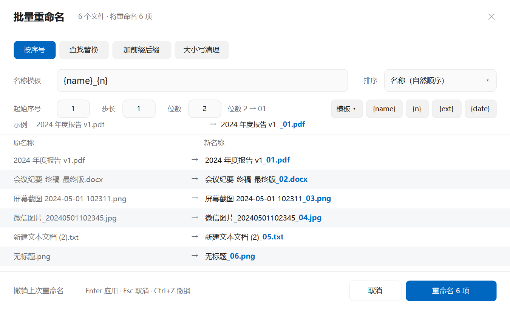
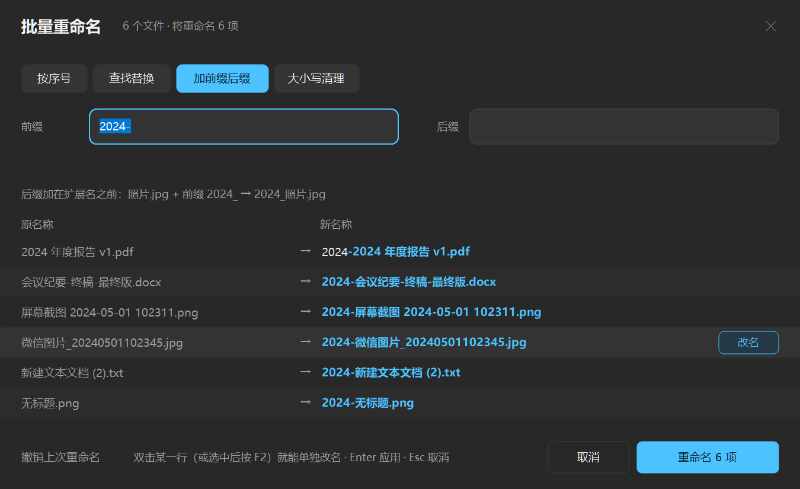
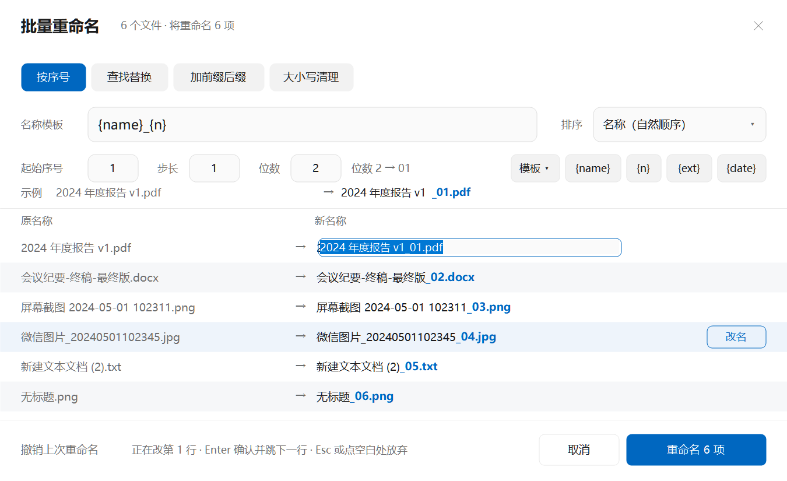

# 批量重命名（资源管理器右键菜单）

选中任意多个文件 → 右键 → **批量重命名**，一个窗口搞定 N 个文件的重命名；规则存下来之后还可以用 **快速重命名** 真正一键套用。

Windows 10 / 11 · .NET Framework 4 · 免管理员权限 · 自带 28 项自测



> 深色模式（跟随系统主题自动切换）：

## 为什么做这个

在资源管理器里给 20 个文件改名，原生做法是重复 20 次【右键 → 重命名 → 输入 → 回车】= 80 次操作。这个工具把它压缩成 2 次：**选中 → 右键 → 批量重命名**，剩下的交给规则和预览。

## 快速开始

```powershell
git clone https://github.com/Yun-zuizhou/Rename-editor.git
cd Rename-editor
powershell -ExecutionPolicy Bypass -File .\Install.ps1
```

仓库里带着编译好的 `dist\BatchRename.exe` 和 `shell\dist\DSHBRShell.dll`，所以**不用装任何 SDK 就能直接安装**。想自己编译见下方「开发」。

只想要经典菜单（不注册新式菜单），用 `Install.ps1 -SkipPackage`。

## 安装

### 方式一：单文件安装包（推荐）

下载 **[dist/RenameEditorSetup.exe](dist/RenameEditorSetup.exe)**，双击即可。无需联网、无需管理员权限、不用装 .NET SDK —— 主程序、菜单扩展 DLL、包清单、包图标全部已嵌在这一个 1.7 MB 的 exe 里。

- 双击 = 安装；再运行一次并加 `--uninstall` = 卸载
- `--silent` 静默安装（无界面），`--dir <路径>` 装到自定义目录
- 装完在资源管理器里选中文件 → 右键 →「批量重命名」

如果系统没开**开发者模式**，一级菜单注册会失败，安装程序会自动退回经典菜单项（在「显示更多选项」/`Shift+F10` 里），并提示你如何打开开发者模式。

### 方式二：从源码安装

exe 只依赖 .NET Framework 4（Win10/11 自带）；菜单扩展是一个原生 COM DLL，通过**松散包注册**挂进 Win11 新式右键菜单，全程不需要管理员权限、不需要签名证书，只写 `HKCU` 和 `%LOCALAPPDATA%`。

需要系统已开启**开发者模式**（设置 → 隐私和安全性 → 开发者选项），因为 `Add-AppxPackage -Register` 依赖它。

```powershell
# 1) 编译（产物在 dist\BatchRename.exe）
powershell -ExecutionPolicy Bypass -File .\Build.ps1

# 2) 安装：复制到 %LOCALAPPDATA%\Programs\DSHBatchRename，注册 COM + 松散包
powershell -ExecutionPolicy Bypass -File .\Install.ps1
```

重新打包单文件安装器：

```powershell
powershell -ExecutionPolicy Bypass -File .\setup\Build-Setup.ps1
```

卸载：

```powershell
powershell -ExecutionPolicy Bypass -File .\Uninstall.ps1              # 删菜单项 + 注销包
powershell -ExecutionPolicy Bypass -File .\Uninstall.ps1 -RemoveFiles # 连 exe、配置一起删
```

安装后会多出这几项（都在**一级**右键菜单里，不用点「显示更多选项」）：

| 位置 | 菜单项 | 行为 |
| --- | --- | --- |
| 选中文件 | 批量重命名… | 打开预览窗口 |
| 选中文件 | 快速重命名（沿用上次规则） | 不弹窗，直接改名并弹一条带「撤销」的提示 |
| 选中文件夹 | 批量重命名… | 重命名文件夹本身 |
| 选中文件夹 | 快速重命名（沿用上次规则） | 同上，直接套用上次规则 |
| 文件夹空白处 | 批量重命名（本文件夹）… | 把该文件夹里的所有条目拉进预览窗口 |
| 文件夹空白处 | 撤销上次批量重命名 | 回滚最近一次 |

> 也可以不安装：直接把 `dist\BatchRename.exe` 拖到任意位置双击运行，或把文件拖进窗口。

## 界面与动线

窗口是自绘的无边框圆角面板，配色跟随系统深浅色（`HKCU\...\Themes\Personalize\AppsUseLightTheme`），150% 缩放下按真实 DPI 渲染，文字是清晰的位图而不是被放大的模糊图。

打开就能用，不用先找输入框：

- 光标直接落在当前规则的**第一个输入框**里（默认规则是「加前缀后缀」，直接敲前缀就完事）。
- 模板不用背语法：模板框右边有 `{name}` `{n}` `{ext}` `{date}` 四个芯片，**点一下就插到光标处**；旁边的「模板 ▾」是六个常用模板，点一下直接套用。
- 顶部四个**分段控件**代替传统页签，一眼看出当前规则。
- 「示例」行用第一个文件实时演示：新名字里**变化的部分用蓝色加粗**标出来，扫一眼就知道规则吃没吃对。
- 主按钮写清后果：`重命名 6 项`；没有可改项时自动变灰。
- 列表按内容自动收窄窗口高度，文件少时不会留一大片空白。
- 悬停只重绘所在的那一行、字体与画刷都带缓存，几百个文件滚动也不掉帧。
- `Enter` 应用、`Esc` 取消、`Ctrl+Z` 撤销，全程不用摸鼠标。
- 「撤销上次重命名」降级成左下角文字链接，不跟主操作抢视线。
- **列表里双击任意一行（或按 F2 / F12，或点行尾的「改名」）就能单独给这条改个名字**；手写过的行右侧标「手动」，规则再怎么调都绕开它。
- 窗口一直开着也能用：把别的文件夹里的文件**直接拖进窗口**，会追加到列表末尾（重复的自动跳过），不用关掉重来。

## 四种改名方式

窗口顶部四个分段控件，左下角「排序依据」决定序号的分配顺序（名称按自然排序，`2` 排在 `10` 前面）。默认落在「3. 加前缀后缀」。

### 1. 按序号

模板 `{name}_{n}{ext}` → `照片_01.jpg`、`照片_02.jpg`…… 可设起始序号、步长、位数（位数 2 → `01`，位数 0 → `1`）。

### 2. 查找替换

纯文本替换，或勾选「正则表达式」用 `$1`、`$2` 引用分组。可区分大小写。只替换主文件名，扩展名不动。

### 3. 加前缀后缀

后缀自动插在扩展名之前：`报告` + 前缀 `2024-` + 后缀 `-终稿` → `2024-报告-终稿.docx`。

### 4. 大小写清理

全部小写 / 全部大写 / 首字母大写；去首尾空格、合并重复空格、空格转下划线。适合清理从网页、微信下载的文件名。

### 逐条手写：四种方式里都能用

「一条一条自己写」不是单独一种模式，而是**叠加在四种方式之上的能力**——因为它跟规则不冲突：规则管没手写过的行，你手写的行由你说了算。

- **双击某一行**（或选中后按 `F2` / `F12`，或把鼠标移到行尾点「改名」）直接在「新名称」列上改：`Enter` 确认并自动跳到下一行，`Esc` 或**点一下空白处**放弃这次改动（点另一行则是保留改动、接着改那一行）。
- 手写过的行右侧标「手动」，之后改模板、调序号、切到别的方式，都不会覆盖它——一批文件里有一条不同类，不用把它挪出去单独处理。
- 手写的行不占序号：`a_01`、你写的名字、`c_02`，序号不会断。
- 想撤销手写，双击它、清空内容回车即可，那一行就回到规则管辖。



### 模板变量

`{name}` 原主文件名、`{n}` 序号、`{i}` 在列表中的位置、`{ext}` 扩展名（含点）、`{date}` 修改日期、`{time}` 修改时间、`{parent}` 上级文件夹名。

## 安全性

- **实时预览**：任何输入改动后立刻刷新「原名称 / 新名称 / 状态」三列。绿色=将改名，红色=冲突，灰色=未变化，银色=已从列表排除。
- **冲突即整体不执行**：目标名已存在、同批次重名、非法字符（`\ / : * ? " < > |`）、超出 255 字符，都会在预览里标红并阻止应用，不会做出改了一半的烂摊子。
- **两阶段改名**：先把所有文件改成临时名再改成目标名，所以 `1→2、2→3、3→4` 这种链式改名一次就能完成。
- **失败回滚**：批量过程中出错会尽量还原已改的项目。
- **撤销**：每次成功改名都写入 `%LOCALAPPDATA%\DSHBatchRename\undo\yyyyMMdd-HHmmss-fff.tsv`（原路径 ⇥ 新路径），保留最近 20 次；撤销同样是两阶段，所以链式改名也能整体还原。
- 列表里**右键**一行即可把它从改名范围里排除（显示「已排除」、不参与改名），再右键恢复正常；避免误改系统文件之类不想动的条目。

## 命令行

| 参数 | 作用 |
| --- | --- |
| （无参数） | 打开空白窗口，可拖入文件 |
| `文件1 文件2 …` | 打开窗口并载入这些文件（右键菜单就是这么调的） |
| `--quick 文件…` | 套用上次保存的规则直接改名，弹提示条（无规则时退回窗口） |
| `--folder 目录…` | 把目录展开成其中的条目再进窗口 |
| `--undo` | 撤销最近一次 |
| `--selftest <输出文件>` | 跑内置 28 项自测，结果写文件，退出码 0/1 |
| `--shot <png> 文件…` | 把主窗口渲染成图片（开发用，验证布局与中文） |

## 开发

```
Rename-editor/
├─ src/
│  ├─ Rename.cs        数据模型：重命名模式、应用目录、规则、单个待改项
│  ├─ Engine.cs        引擎：预览、冲突校验、两阶段改名、撤销
│  ├─ Program.cs       入口：命令行解析、GUI 启动、提示条、离线截图
│  ├─ SelfTest.cs      内置自测（--selftest，28 项）
│  ├─ UiForm.cs        主窗口（自绘、布局、预览、交互）
│  ├─ RowEditor.cs     列表里的行内改名输入框（摆放 / 提交 / 放弃）
│  ├─ UiTheme.cs       配色 / 字体缓存 / 绘图基元（Brush·Pen·文字宽度缓存）/ 无边框圆角窗体 / 下拉浮层
│  ├─ Dev.cs           开发期环境变量开关（正常使用不读）
│  └─ app.manifest     DPI 感知 + 长路径
│  （Build.ps1 按文件名顺序编译 src\*.cs，新增文件不用改脚本）
├─ shell/
│  ├─ ShellCommand.cpp IExplorerCommand 实现（6 个菜单动词）
│  ├─ Build-Shell.ps1  用 MSVC 编译成 dist/DSHBRShell.dll
│  └─ ComProbe.cpp     命令行探针：验证 COM 类的标题/图标/状态
├─ msix/
│  ├─ AppxManifest.xml  包清单（声明 comServer + fileExplorerContextMenus）
│  └─ stage/Assets/     包内三张图标（Square44/150、StoreLogo）
├─ tools/
│  ├─ MakeIcon.cs       生成三个菜单图标（.ico，16–256 多尺寸）
│  ├─ Shot-ShellMenu.ps1 截取真实右键菜单（开发用）
│  └─ Register-LoosePackage.ps1  松散包注册的幂等封装
├─ setup/
│  ├─ Setup.cs          单文件安装/卸载器（把下面四样嵌进一个 exe）
│  └─ Build-Setup.ps1   打包 dist/RenameEditorSetup.exe
├─ shell/dist/          编译产物：DSHBRShell.dll、ComProbe.exe
├─ docs/                README 用的界面截图
├─ Pack-Shell.ps1      打 msix（仅用于验证清单，实际安装走松散注册）
├─ Build.ps1           调 csc 编译，-RunSelfTest 跑自测
├─ Install.ps1         装（复制 + 注册 COM + 松散包注册）
├─ Uninstall.ps1       卸
├─ demo/               试手用的样本文件（故意起得很乱）
├─ dist/BatchRename.exe         产物（单文件，约 64 KB）
└─ dist/RenameEditorSetup.exe   单文件安装包（约 1.7 MB，双击即装）
```

```powershell
powershell -ExecutionPolicy Bypass -File .\Build.ps1 -RunSelfTest
```

自测覆盖：自然排序、模板展开、正则分组、前后缀位置、大小写与清理规则、非法字符、目标存在、同批重名、链式改名、撤销链式改名、文件夹改名、手动改名与序号互不干扰、切方式后手写名仍保留。

开发期开关（见 `src/Dev.cs`）：`DSHBR_THEME=light|dark` 强制配色、`DSHBR_SHOT_MODE=0..3` 强制规则页签、`DSHBR_SHOT_AFFIX=<前缀>` 预填前缀、`DSHBR_DEBUG=1` 把窗口尺寸写进 `%TEMP%\dshbr-ui.log`。配合 `BatchRename.exe --shot 输出.png 文件…` 可以离屏渲染出界面图，文档里的截图就是这么来的。

## 关于 Win11 的右键菜单

Windows 11 的**新式**一级右键菜单不认 `HKCU\Software\Classes\*\shell` 这种传统注册方式，只认**实现了 `IExplorerCommand` 的打包应用**。本工具的菜单扩展就是按这条路做的：

1. `shell/DSHBRShell.dll` 实现 `IExplorerCommand`（`GetTitle` / `GetIcon` / `GetState` / `Invoke`），6 个菜单动词共用一份实现、靠 CLSID 分派。
2. `msix/AppxManifest.xml` 声明 `com:SurrogateServer` + `desktop4:FileExplorerContextMenus`（`*`、`Directory`、`Directory\Background`）。
3. `Install.ps1` 用 `Add-AppxPackage -Register` 做**松散文件注册**——不走签名和 MSIX 安装包，所以不需要证书；注册后系统会在 `PackagedCom\ClassIndex` 里挂上这 6 个 CLSID，资源管理器据此加载扩展。

如果这台机器没开开发者模式（注册会失败），或者你更习惯经典菜单，有两条退路：

1. **快捷键**：选中文件 → `Shift+F10` → 「显示更多选项」里的传统项（`Install.ps1 -ClassicMenu` 才会写传统项）。
2. **恢复经典菜单**：`powershell -ExecutionPolicy Bypass -File .\Install.ps1 -ClassicMenu`，把整个右键菜单变回 Win10 样式。这是用户级设置，`Uninstall.ps1` 会还原。

外观上能自定义的只有菜单项的**文字**和 **20px 图标**（行高、配色、圆角都由系统绘制），所以这部分的设计重点放在图标本身：`tools/MakeIcon.cs` 生成三个变体（蓝=主功能、橙=快速、灰蓝=撤销），16–256 多尺寸 32bpp。

## 已知限制

- 只处理同一文件夹层面的批量改名，不递归子目录。
- 菜单扩展（`DSHBRShell.dll`）是 **x64**，32 位 Windows 上用不了（exe 本身与位数无关，直接双击仍可运行）。
- 新式菜单依赖开发者模式才能松散注册；没开时只能用 `-ClassicMenu` 或直接把文件拖进窗口。
- 无权限的位置（系统目录、部分 OneDrive 场景）会在预览里标红并跳过，不会中途炸掉。

## 支持这个项目

如果它帮你省下了反复「右键 → 重命名」的时间：

- 给个 ⭐ Star 就是最好的支持
- 想请我喝杯咖啡：[爱发电](https://afdian.com/a/hs007)
